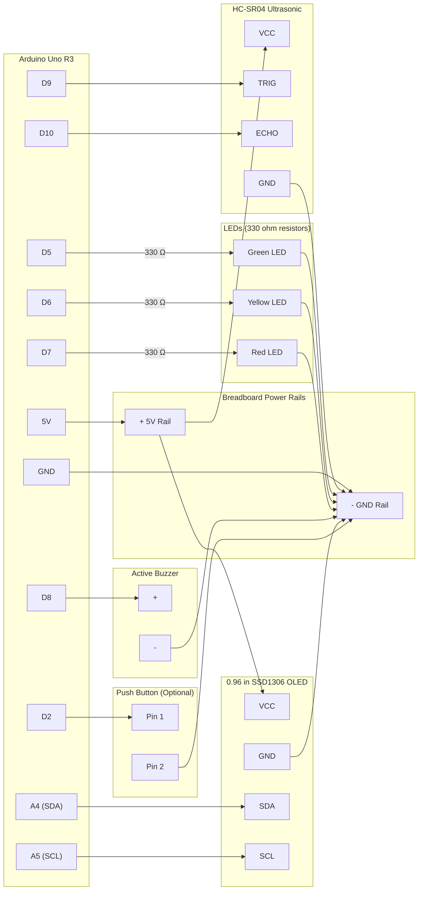

# Arduino Uno R3 — Helicopter VDGS Wiring Guide

Exact breadboard wiring for [helicopter-vdgs-arduino.ino](file:///d:/app%20dev/helicopter-vdgs-arduino/helicopter-vdgs-arduino.ino).

---

## Schematic Overview

---

## Step-by-Step Breadboard Checklist (Zero Mistakes)

### 1. Power Rails First
- **Arduino `5V`** → Breadboard **`+` rail**
- **Arduino `GND`** → Breadboard **`-` rail**
- *(Keep all `+` and `-` wires on the **same half** of the breadboard rails in case your breadboard has a split in the middle.)*

### 2. HC-SR04 Ultrasonic Sensor (4 pins)
Plug into **4 separate 5-hole rows** on the breadboard:
- **`VCC`** → **`+` rail (`5V`)**
- **`TRIG`** → **Arduino `D9`**
- **`ECHO`** → **Arduino `D10`**
- **`GND`** → **`-` rail (`GND`)**

### 3. Three LEDs (with `330 Ω` Resistors)
For **each** LED: **longer leg = `+` (anode)**, **shorter leg / flat edge = `-` (cathode)**.
- **Green LED:** `D5` → `330 Ω` resistor → **Green `+`**, **Green `-`** → **`-` rail (`GND`)**
- **Yellow LED:** `D6` → `330 Ω` resistor → **Yellow `+`**, **Yellow `-`** → **`-` rail (`GND`)**
- **Red LED:** `D7` → `330 Ω` resistor → **Red `+`**, **Red `-`** → **`-` rail (`GND`)**

### 4. Active Buzzer
- **`+` (longer leg / `+` mark)** → **Arduino `D8`**
- **`-` (shorter leg)** → **`-` rail (`GND`)**

### 5. 0.96" SSD1306 I2C OLED (4 pins)
- **`VCC`** → **`+` rail (`5V`)**
- **`GND`** → **`-` rail (`GND`)**
- **`SDA`** → **Arduino `A4`**
- **`SCL`** → **Arduino `A5`**

### 6. Model Select Push Button *(Optional)*
- **One leg** → **Arduino `D2`**
- **Opposite leg** → **`-` rail (`GND`)**
